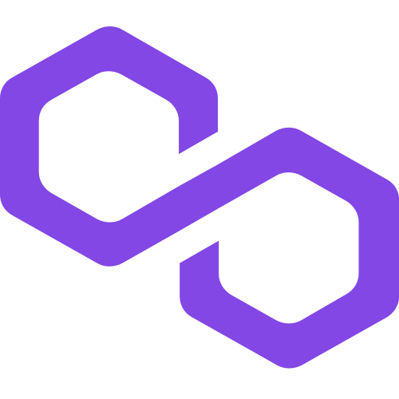

<div align="center">

# AiFinPay: AI Agent Payments


### Non-custodial pay-per-call payments for autonomous AI agents

Give agents a way to pay for digital services one request at a time, without subscriptions or a custodial payment intermediary.

[AiFinPay website](https://aifinpay.io) · [Developer documentation](https://docs.aifinpay.io) · [AI agent integration guide](https://github.com/AiFinPay/aifinpay-agent-integration)

</div>

---

## What is AiFinPay?

AiFinPay gives any AI agent a wallet so it can pay for services and receive payments on-chain. Built on the open **x402** protocol and **AIFP** standards, it enables autonomous machine-to-machine commerce with exact, per-call settlement across multiple blockchains.

- **Pay-per-call** — agents settle each invocation exactly, no subscriptions, no pre-funding.
- **Non-custodial** — payments flow directly wallet-to-wallet; no intermediary holds funds.
- **Multi-chain** — EVM, Solana, Aptos and more (and growing).
- **Agent-first** — MCP server and SDK make it straightforward to integrate with agent frameworks.

## Why AiFinPay?

AI agents increasingly need access to resources that cost money: an API call, a premium research article, a dataset, a search result, a software tool, or a machine-readable service.

AiFinPay gives developers the building blocks to turn that access into an owner-controlled payment workflow.

| Capability | What it enables |
| :---- | :---- |
| **Agent payments** | Buy access to AiFinPay-enabled websites, APIs, data, content, and tools. |
| **Non-custodial Agent Wallet** | Keep signing keys with the agent owner or operator instead of handing them to a payment intermediary. |
| **Agent Passport (AIFP-3)** | A portable agent identity model with verifiable wallet ownership; global passport issuance is being rolled out. |
| **14-network infrastructure inventory** | Multi-chain wallet and payment architecture with network-specific readiness checks; not every listed network is payment-enabled. |
| **HTTP 402 / x402-compatible architecture** | Discover paid resources, authorize supported payment routes, and reuse verified access receipts. |
| **0% AiFinPay fee on AIFP-2 / x402** | The current AIFP-2 protocol fee is 0%; payment availability and external network costs are separate. |
| **Budget controls** | Configure allowed merchants, spending limits, and payment permissions. |
| **Receipts and payment history** | Track settled payments and access entitlements. |
| **Merchant monetization** | Charge AI agents for eligible access to websites, APIs, MCP tools, and premium resources. |

## Protocol & Standards

| Repo                                         | Description |
|----------------------------------------------|---|
| [AIFP_1](https://github.com/AiFinPay/AIFP-1) | Open protocol for AI-native payments, paywalls, agent identity, and autonomous M2M commerce. |
| [AIFP_2](https://github.com/AiFinPay/AIFP-2) | Core agent payment protocol — routing, wallet policy, settlement verification and receipts; x402 v2 compatibility profile. |
| [AIFP_3](https://github.com/AiFinPay/AIFP-3) | Global Agent Passport — immutable identity, issuer/holder keys, lifecycle, and verified wallet bindings. |
| [AIFP_4](https://github.com/AiFinPay/AIFP-4) | Open organization / corporation protocol. |
| [AIFP_5](https://github.com/AiFinPay/AIFP-5-Quantum-Safe-Financial-Protocol) | Quantum-safe authorization envelopes — classical, hybrid, and post-quantum cryptographic authorization. |
| [AIFP_6](https://github.com/AiFinPay/AIFP-6-Agentic-Financial-Governance-Protocol) | Agentic financial governance — machine-readable authority, limits, delegation, approvals, emergency controls and audit decisions. |

## On-Chain Contracts

| Repo | Chain | Language | Highlights |
|---|---|---|---|
| [evm-contract](https://github.com/AiFinPay/evm-contract) | See supported | Solidity | `AiFinPayCore v1.1` with Pyth Pull Oracle. |
| [solana-contract](https://github.com/AiFinPay/solana-contract) | Solana | Rust | Anchor program — Seat PDAs, `b2b_pay`, `b2b_pay_with_split`. Live on mainnet. |

## Tools & Integrations

| Repo | Description |
|---|---|
| [sdk](https://github.com/AiFinPay/sdk) | TypeScript SDK for embedding AiFinPay into agents and services. |
| [aifinpay-cli](https://github.com/AiFinPay/aifinpay-cli) | Agent-first CLI (Go). Pay-per-call x402 + on-chain settlement; wraps `@aifinpay/mcp`. |
| [aifinpay-agent-integration](https://github.com/AiFinPay/aifinpay-agent-integration) | Official integration guide — give any AI agent a wallet (MCP + SDK). |
| [stellar-x402-facilitator](https://github.com/AiFinPay/stellar-x402-facilitator) | Open-source x402 facilitator & Bazaar discovery layer for Stellar. |

## Documentation

- [AiFinPay developer documentation](https://github.com/AiFinPay/docs) — Mintlify documentation source.

## Network Coverage and Status

AiFinPay tracks **14 mainnet networks**. Payment support and deployment status vary by chain, protocol, asset, and route; check the live capabilities and network status before integrating.

EVM compatible
<table>
  <tr>
    <td align="center"><a href="https://github.com/AiFinPay/evm-contract"><br>Arc</a></td>
    <td align="center"><a href="https://github.com/AiFinPay/evm-contract/blob/main/deployments/avalanche-v14-avalanche-latest.json"><br>Avalanche</a></td>
    <td align="center"><a href="https://github.com/AiFinPay/evm-contract/blob/main/deployments/arbitrum-v14-arbitrum-latest.json"><br>Arbitrum</a></td>
    <td align="center"><a href="https://github.com/AiFinPay/evm-contract/blob/main/deployments/polygon-v14-polygon-latest.json"><br>Polygon</a></td>
  </tr> 
  <tr>
    <td align="center"><a href="https://github.com/AiFinPay/evm-contract/blob/main/deployments/bnb-v14-bnb-latest.json"><br>BNB Chain</a></td>
    <td align="center"><a href="https://github.com/AiFinPay/evm-contract/blob/main/deployments/base-v14-base-latest.json"><br>Base</a></td>
    <td align="center"><a href="https://github.com/AiFinPay/evm-contract/blob/main/deployments/robinhood-v14-robinhood-latest.json"><br>Robinhood</a></td>
    <td align="center"><a href="https://github.com/AiFinPay/evm-contract/blob/main/deployments/optimism-v14-optimism-latest.json"><br>Optimism</a></td>
  </tr>
  <tr>
    <td align="center"><a href="https://github.com/AiFinPay/evm-contract/blob/main/deployments/xrplevm-v14-xrplevm-latest.json"><br>XRPL EVM</a></td>
    <td align="center"><a href="https://github.com/AiFinPay/evm-contract/blob/main/deployments/unichain-v14-unichain-latest.json"><br>Unichain</a></td>
    <td align="center"><a href="https://github.com/AiFinPay/evm-contract"><br>BOT Chain</a></td>
  </tr>
</table>

Non EVM
<table>
  <tr>
    <td align="center"><a href="https://github.com/AiFinPay/solana-contract"><br>Solana</a></td>
    <td align="center"><a href="https://github.com/AiFinPay/near-contract"><br>NEAR</a></td>
    <td align="center"><a href="https://github.com/AiFinPay/aptos-contract"><br>Aptos</a></td>
  </tr>
</table>

Live state varies per chain — see the
[network source-of-truth](https://github.com/AiFinPay/knowledge-vault/blob/main/docs/10-projects/aifinpay/network-source-of-truth.md)
for the per-layer status matrix.

## Getting Started

Install the package(s) you need and give your agent a funded wallet:

```bash
# MCP server — plug any agent framework into AiFinPay
npm install @aifinpay/mcp

# Opinionated agent runtime (optional)
npm install @aifinpay/agents

# Or scaffold a full integration
npx @aifinpay/cli init
```

Then point your agent at the MCP server and give it a funded wallet. See the
[integration guide](https://github.com/AiFinPay/aifinpay-agent-integration) for details.

### Built for the developer ecosystem

Use AiFinPay with JavaScript/TypeScript applications, supported Python workflows, MCP-enabled AI systems, and agents that support the Agent Skills format. Pick the integration that matches your runtime:

| Need | Start here |
| :---- | :---- |
| **Node.js / TypeScript agent SDK** | `npm install @aifinpay/agent` |
| **AI agent skill** | `npx skills add AiFinPay/skill` |
| **MCP tools** | `npx -y @aifinpay/mcp@latest` |
| **Python agent SDK** | `pip install aifinpay-agent` |
| **Node merchant paywall** | `npm install @aifinpay/gate` |
| **Python merchant paywall** | `pip install aifinpay-gate` |
| **Dashboard** | [dash.aifinpay.io](https://dash.aifinpay.io) |

### Developer-first security

AiFinPay's non-custodial approach keeps key ownership local. Supported payment clients check merchant identity, configured owner limits, route activation, the chosen asset, and settlement evidence before treating access as paid.

- No secret keys in the public passport, request metadata, or README examples.
- No assumption that a 402 response, quote, or invoice means money moved.
- No automatic settlement on a disabled or unverified network.
- No second payment when the outcome of an earlier signed transaction is unresolved; follow the recovery process.

[Read payment authorization and recovery details](https://github.com/AiFinPay/sdk/blob/main/node/PAYMENT_RECEIPTS.md)

## Documentation and links

- **Website:** [AiFinPay](https://aifinpay.io)
- **Quickstart:** [Developer quickstart guide](https://docs.aifinpay.io/quickstart)
- **Documentation:** [AiFinPay developer documentation](https://docs.aifinpay.io)
- **Agent Skill:** [AiFinPay Agent Skill](https://github.com/AiFinPay/skill)
- **SDK source:** [AiFinPay SDK on GitHub](https://github.com/AiFinPay/sdk)
- **Dashboard:** [AiFinPay dashboard](https://dash.aifinpay.io)
- **Merchant onboarding:** [Merchant onboarding guide](https://docs.aifinpay.io/charge/onboarding)
- **Live network capabilities:** [Payment capabilities API](https://aifinpay.io/api/payment-capabilities)
- **Machine-readable agent instructions:** [AiFinPay llms.txt](https://aifinpay.io/llms.txt)

**For builders:** equip your agents to pay for the resources they need.

**For merchants:** turn eligible AI traffic into paid access to your content, APIs, and services.

**AiFinPay — the payment infrastructure layer for AI.**

## License

MIT. See [LICENSE](https://github.com/AiFinPay/sdk/blob/main/node/LICENSE).